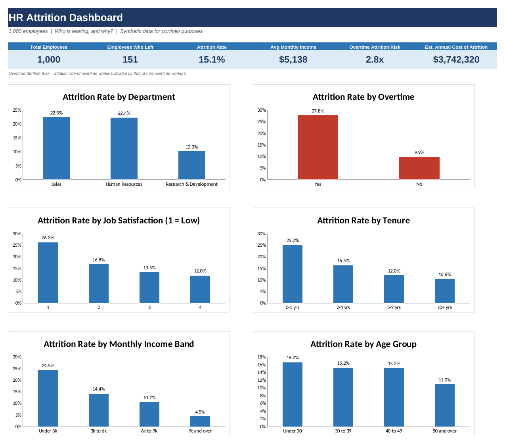

# HR Employee Attrition Analysis (Excel)

An Excel project that investigates **why employees leave a company, which groups are most at risk, and what HR should do about it**. It includes a formula-driven analysis, an interactive-style dashboard, and written business recommendations.

> **Data note:** The dataset (1,000 employees) is **synthetic**. It was generated for this portfolio project and contains no real people or company information. The focus of the project is the analysis method and the Excel skills shown.



---

## 1. Business Problem

A company has lost **151 of its 1,000 employees (15.1%)**. Replacing staff is expensive (recruiting, onboarding, lost productivity), so HR leadership asked:

1. How big is the attrition problem, and what does it cost?
2. Which departments, roles and employee groups lose the most people?
3. What factors (overtime, satisfaction, pay, tenure, age) are linked to leaving?
4. What should HR do first to reduce attrition?

## 2. Dataset

| Column | Description |
|---|---|
| EmployeeID | Unique employee code |
| Age | Age in years |
| Gender | Male / Female |
| Department | Research & Development, Sales, Human Resources |
| JobRole | Job title (9 roles) |
| MonthlyIncome | Gross monthly pay (US$) |
| YearsAtCompany | Completed years of service |
| OverTime | Yes / No: regularly works overtime |
| JobSatisfaction | 1 = Low, 2 = Medium, 3 = High, 4 = Very High |
| WorkLifeBalance | 1 = Bad to 4 = Best |
| DistanceFromHome_km | Commute distance in km |
| YearsSinceLastPromotion | Years since last promotion |
| Attrition | **Yes** = employee left (the outcome being studied) |

Three **helper columns** were added with formulas: `AgeGroup`, `TenureBand`, `IncomeBand`.

## 3. Workbook Structure

| Sheet | Purpose |
|---|---|
| **README** | Objective, data dictionary and sheet guide |
| **Dashboard** | 6 KPI tiles and 6 charts (start here) |
| **Insights** | Findings written with formulas, so they update when the data changes, plus recommendations |
| **Analysis** | 9 summary tables, all built with formulas, plus one editable assumption |
| **Raw Data** | The 1,000 employee records and the 3 helper columns |

## 4. Excel Skills Demonstrated

- **Conditional aggregation:** `COUNTIFS`, `SUMIFS`, `AVERAGEIFS`
- **Logic and error handling:** `IF` (nested, for banding), `IFERROR`
- **Absolute and mixed references** (`$A19`, `B$90`) so formulas copy correctly
- **Dynamic text:** `TEXT()` and `&` to build findings that refresh automatically
- **Conditional formatting:** colour scales to highlight high-risk groups
- **Charts and a KPI dashboard**
- **Documented assumptions:** one clearly marked input cell (yellow) that drives the cost estimate
- **Data structuring:** frozen panes, filters, consistent number formats, print setup

## 5. Method

1. **Reviewed the data** and defined the outcome: `Attrition = "Yes"`.
2. **Created helper columns** to group age, tenure and income into bands.
3. **Built summary tables** (Analysis sheet). For each group: headcount, leavers, *attrition rate = leavers / headcount*, average income and share of all leavers.
4. **Built a cross-tab** of overtime x job satisfaction to find the highest-risk combination.
5. **Estimated the cost of attrition:** total annual pay of leavers x 50% replacement-cost assumption (changeable in one cell).
6. **Visualised** the main drivers on the Dashboard.
7. **Wrote insights and recommendations.**

## 6. Key Findings

| Finding | Result |
|---|---|
| Overall attrition | **15.1%** (151 of 1,000) |
| Estimated annual cost | **about $3.74M** (assuming replacement cost = 50% of annual salary) |
| Overtime | Overtime workers leave at **27.8%** vs **9.9%** for others (**2.8x higher**). 54% of all leavers worked overtime |
| Job satisfaction | Rating 1 (Low): **26.3%**. Rating 4 (Very High): **12.0%** |
| Tenure | 0-1 years: **25.2%**. 10+ years: **10.6%** |
| Income | Under $3k/month: **24.5%**. $9k and over: **4.5%** |
| Department | Sales **22.5%**, Human Resources **22.4%**, R&D **10.3%** |
| Job role | Sales Representative **30.5%** (highest); Sales Manager and Research Director under 5% |
| Highest-risk combination | Overtime + Low satisfaction: **43.6%** attrition |
| Age and gender | Smaller effects (under-30s 16.7%, over-50s 11.0%; women 17.2%, men 13.5%) |

## 7. Recommendations

1. **Audit and cap overtime.** It is the strongest driver; rebalance workloads or hire in teams where overtime is routine.
2. **Launch a first-year retention programme:** structured onboarding, 30/60/90-day manager check-ins and mentoring.
3. **Run pulse surveys** and follow up quickly on satisfaction scores of 1-2, especially for overtime workers.
4. **Review pay and promotion paths** for the lowest-paid roles (e.g. Sales Representatives).
5. **Refresh quarterly:** paste new data into `Raw Data` and the tables, charts and findings update.

## 7b. Limitations

- The data is synthetic, so the patterns illustrate the method and are not evidence about any real company.
- The analysis shows **association, not causation**. For example, overtime is linked with leaving, but this analysis cannot prove it causes it.
- The $3.74M cost depends on the 50% replacement-cost assumption.
- Some groups are small (e.g. 6 HR Managers), so their rates should be read with caution.

## 8. How to Use This Workbook

1. Download `HR_Attrition_Analysis_Excel.xlsx` (open the file in this repo and click the **download** icon).
2. Open it in Microsoft Excel (or Google Sheets / LibreOffice).
3. Start on the **Dashboard**, then read **Insights**.
4. Click any cell on the **Analysis** sheet to see the formula behind it.
5. Change the yellow cell on **Analysis** (replacement cost %) to see the cost estimate update.

## 9. Repository Contents

```
.
├── HR_Attrition_Analysis_Excel.xlsx   # the full workbook
├── README.md                          # this file
└── images/
    └── dashboard.png                  # dashboard screenshot
```

## 10. About Me

**[Evbade Taiwo]**: aspiring Data Analyst
LinkedIn: [https://www.linkedin.com/in/taiwo-evbade-38b764329/] | Email: [evbadetaiwo2@gmail.com]
